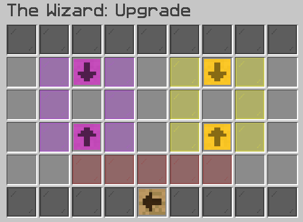

# Wizard


This feature is exclusive to our **Towny** server



In-game command: **/warp Wizard**


## What is the Wizard?

The Wizard is your go-to to upgrade or repair your enchantment books.

### How to use the GUI

<figure><figcaption></figcaption></figure>

To use the above GUI, all you simply need to do is place the book you want to upgrade in the purple slot, hover over the red bar and it'll tell you how many ancient coins you need. If you have enough, put them in the yellow slot and you'll be able to upgrade the enchantment.

To reduce the risk-level of the upgrade failing, you can add more coins - the red/green bar will tell you how many.

### How do I get Ancient Coins?

You can get ancient coins from mining or digging - you don't need to be in the relevant job to get the drops.

You may come across Ancient Coin Fragments, these can be crafted into useable ancient coins via a crafting table.

<figure><figcaption></figcaption></figure>

Enchanted Ancient Coins are an ultra-rare drop (also included in crate & daily rewards) that are a one-time use, guaranteed 100% successful upgrade or repair.

## Enchantment Upgrades

Upgrade your gear beyond vanilla enchantment limits. Each enchantment below lists the server's maximum level, the coins required for each upgrade attempt, and its failure-risk tier.

### How to read this guide

* **Upgrade:** The current level and the level you are upgrading to. For example, **1 to 2** upgrades an existing level 1 enchantment to level 2.
* **Coins per attempt:** The base number of Ancient Coins required for that upgrade attempt. Additional coins used to reduce risk are not included.
* **Risk level:** The failure-risk tier before any risk reduction.
* **Maximum level:** The highest level available for that enchantment on this server.

> Costs are per attempt, not a guaranteed total to reach a level. The tables cover upgrades from level 1 onward, not applying an enchantment to an unenchanted item.

#### Risk tiers

From lowest to highest:

| Risk level |
| ---------- |
| No Risk    |
| Low        |
| Medium     |
| High       |
| Very High  |

### Bane of Arthropods

**Maximum level: 9**

| Upgrade | Coins per attempt | Risk level |
| ------- | ----------------- | ---------- |
| 1 to 2  | 2                 | Low        |
| 2 to 3  | 2                 | Low        |
| 3 to 4  | 3                 | Medium     |
| 4 to 5  | 4                 | Medium     |
| 5 to 6  | 4                 | High       |
| 6 to 7  | 5                 | High       |
| 7 to 8  | 6                 | Very High  |
| 8 to 9  | 6                 | Very High  |

### Blast Protection

**Maximum level: 6**

| Upgrade | Coins per attempt | Risk level |
| ------- | ----------------- | ---------- |
| 1 to 2  | 4                 | Medium     |
| 2 to 3  | 4                 | High       |
| 3 to 4  | 5                 | High       |
| 4 to 5  | 6                 | Very High  |
| 5 to 6  | 6                 | Very High  |

### Breach

**Maximum level: 6**

| Upgrade | Coins per attempt | Risk level |
| ------- | ----------------- | ---------- |
| 1 to 2  | 4                 | Medium     |
| 2 to 3  | 4                 | High       |
| 3 to 4  | 5                 | High       |
| 4 to 5  | 6                 | Very High  |
| 5 to 6  | 6                 | Very High  |

### Density

**Maximum level: 7**

| Upgrade | Coins per attempt | Risk level |
| ------- | ----------------- | ---------- |
| 1 to 2  | 3                 | Medium     |
| 2 to 3  | 4                 | Medium     |
| 3 to 4  | 4                 | High       |
| 4 to 5  | 5                 | High       |
| 5 to 6  | 6                 | Very High  |
| 6 to 7  | 6                 | Very High  |

### Depth Strider

**Maximum level: 5**

| Upgrade | Coins per attempt | Risk level |
| ------- | ----------------- | ---------- |
| 1 to 2  | 4                 | High       |
| 2 to 3  | 5                 | High       |
| 3 to 4  | 6                 | Very High  |
| 4 to 5  | 6                 | Very High  |

### Efficiency

**Maximum level: 10**

| Upgrade | Coins per attempt | Risk level |
| ------- | ----------------- | ---------- |
| 1 to 2  | 1                 | No Risk    |
| 2 to 3  | 1                 | Low        |
| 3 to 4  | 2                 | Low        |
| 4 to 5  | 3                 | Medium     |
| 5 to 6  | 4                 | Medium     |
| 6 to 7  | 4                 | High       |
| 7 to 8  | 5                 | High       |
| 8 to 9  | 6                 | Very High  |
| 9 to 10 | 6                 | Very High  |

### Feather Falling

**Maximum level: 7**

| Upgrade | Coins per attempt | Risk level |
| ------- | ----------------- | ---------- |
| 1 to 2  | 3                 | Medium     |
| 2 to 3  | 4                 | Medium     |
| 3 to 4  | 4                 | High       |
| 4 to 5  | 5                 | High       |
| 5 to 6  | 6                 | Very High  |
| 6 to 7  | 6                 | Very High  |

### Fire Aspect

**Maximum level: 4**

| Upgrade | Coins per attempt | Risk level |
| ------- | ----------------- | ---------- |
| 1 to 2  | 5                 | High       |
| 2 to 3  | 6                 | Very High  |
| 3 to 4  | 6                 | Very High  |

### Fortune

**Maximum level: 6**

| Upgrade | Coins per attempt | Risk level |
| ------- | ----------------- | ---------- |
| 1 to 2  | 4                 | Medium     |
| 2 to 3  | 4                 | High       |
| 3 to 4  | 5                 | High       |
| 4 to 5  | 6                 | Very High  |
| 5 to 6  | 6                 | Very High  |

### Frost Walker

**Maximum level: 4**

| Upgrade | Coins per attempt | Risk level |
| ------- | ----------------- | ---------- |
| 1 to 2  | 5                 | High       |
| 2 to 3  | 6                 | Very High  |
| 3 to 4  | 6                 | Very High  |

### Impaling

**Maximum level: 8**

| Upgrade | Coins per attempt | Risk level |
| ------- | ----------------- | ---------- |
| 1 to 2  | 2                 | Low        |
| 2 to 3  | 3                 | Medium     |
| 3 to 4  | 4                 | Medium     |
| 4 to 5  | 4                 | High       |
| 5 to 6  | 5                 | High       |
| 6 to 7  | 6                 | Very High  |
| 7 to 8  | 6                 | Very High  |

### Knockback

**Maximum level: 4**

| Upgrade | Coins per attempt | Risk level |
| ------- | ----------------- | ---------- |
| 1 to 2  | 5                 | High       |
| 2 to 3  | 6                 | Very High  |
| 3 to 4  | 6                 | Very High  |

### Looting

**Maximum level: 6**

| Upgrade | Coins per attempt | Risk level |
| ------- | ----------------- | ---------- |
| 1 to 2  | 4                 | Medium     |
| 2 to 3  | 4                 | High       |
| 3 to 4  | 5                 | High       |
| 4 to 5  | 6                 | Very High  |
| 5 to 6  | 6                 | Very High  |

### Loyalty

**Maximum level: 5**

| Upgrade | Coins per attempt | Risk level |
| ------- | ----------------- | ---------- |
| 1 to 2  | 4                 | High       |
| 2 to 3  | 5                 | High       |
| 3 to 4  | 6                 | Very High  |
| 4 to 5  | 6                 | Very High  |

### Luck of the Sea

**Maximum level: 6**

| Upgrade | Coins per attempt | Risk level |
| ------- | ----------------- | ---------- |
| 1 to 2  | 4                 | Medium     |
| 2 to 3  | 4                 | High       |
| 3 to 4  | 5                 | High       |
| 4 to 5  | 6                 | Very High  |
| 5 to 6  | 6                 | Very High  |

### Lure

**Maximum level: 6**

| Upgrade | Coins per attempt | Risk level |
| ------- | ----------------- | ---------- |
| 1 to 2  | 4                 | Medium     |
| 2 to 3  | 4                 | High       |
| 3 to 4  | 5                 | High       |
| 4 to 5  | 6                 | Very High  |
| 5 to 6  | 6                 | Very High  |

### Piercing

**Maximum level: 6**

| Upgrade | Coins per attempt | Risk level |
| ------- | ----------------- | ---------- |
| 1 to 2  | 4                 | Medium     |
| 2 to 3  | 4                 | High       |
| 3 to 4  | 5                 | High       |
| 4 to 5  | 6                 | Very High  |
| 5 to 6  | 6                 | Very High  |

### Power

**Maximum level: 8**

| Upgrade | Coins per attempt | Risk level |
| ------- | ----------------- | ---------- |
| 1 to 2  | 2                 | Low        |
| 2 to 3  | 3                 | Medium     |
| 3 to 4  | 4                 | Medium     |
| 4 to 5  | 4                 | High       |
| 5 to 6  | 5                 | High       |
| 6 to 7  | 6                 | Very High  |
| 7 to 8  | 6                 | Very High  |

### Projectile Protection

**Maximum level: 6**

| Upgrade | Coins per attempt | Risk level |
| ------- | ----------------- | ---------- |
| 1 to 2  | 4                 | Medium     |
| 2 to 3  | 4                 | High       |
| 3 to 4  | 5                 | High       |
| 4 to 5  | 6                 | Very High  |
| 5 to 6  | 6                 | Very High  |

### Protection

**Maximum level: 6**

| Upgrade | Coins per attempt | Risk level |
| ------- | ----------------- | ---------- |
| 1 to 2  | 4                 | Medium     |
| 2 to 3  | 4                 | High       |
| 3 to 4  | 5                 | High       |
| 4 to 5  | 6                 | Very High  |
| 5 to 6  | 6                 | Very High  |

### Punch

**Maximum level: 5**

| Upgrade | Coins per attempt | Risk level |
| ------- | ----------------- | ---------- |
| 1 to 2  | 4                 | High       |
| 2 to 3  | 5                 | High       |
| 3 to 4  | 6                 | Very High  |
| 4 to 5  | 6                 | Very High  |

### Quick Charge

**Maximum level: 5**

| Upgrade | Coins per attempt | Risk level |
| ------- | ----------------- | ---------- |
| 1 to 2  | 4                 | High       |
| 2 to 3  | 5                 | High       |
| 3 to 4  | 6                 | Very High  |
| 4 to 5  | 6                 | Very High  |

### Respiration

**Maximum level: 5**

| Upgrade | Coins per attempt | Risk level |
| ------- | ----------------- | ---------- |
| 1 to 2  | 4                 | High       |
| 2 to 3  | 5                 | High       |
| 3 to 4  | 6                 | Very High  |
| 4 to 5  | 6                 | Very High  |

### Riptide

**Maximum level: 5**

| Upgrade | Coins per attempt | Risk level |
| ------- | ----------------- | ---------- |
| 1 to 2  | 4                 | High       |
| 2 to 3  | 5                 | High       |
| 3 to 4  | 6                 | Very High  |
| 4 to 5  | 6                 | Very High  |

### Sharpness

**Maximum level: 9**

| Upgrade | Coins per attempt | Risk level |
| ------- | ----------------- | ---------- |
| 1 to 2  | 1                 | Low        |
| 2 to 3  | 2                 | Low        |
| 3 to 4  | 3                 | Medium     |
| 4 to 5  | 4                 | Medium     |
| 5 to 6  | 4                 | High       |
| 6 to 7  | 5                 | High       |
| 7 to 8  | 6                 | Very High  |
| 8 to 9  | 6                 | Very High  |

### Smite

**Maximum level: 9**

| Upgrade | Coins per attempt | Risk level |
| ------- | ----------------- | ---------- |
| 1 to 2  | 1                 | Low        |
| 2 to 3  | 2                 | Low        |
| 3 to 4  | 3                 | Medium     |
| 4 to 5  | 4                 | Medium     |
| 5 to 6  | 4                 | High       |
| 6 to 7  | 5                 | High       |
| 7 to 8  | 6                 | Very High  |
| 8 to 9  | 6                 | Very High  |

### Soul Speed

**Maximum level: 5**

| Upgrade | Coins per attempt | Risk level |
| ------- | ----------------- | ---------- |
| 1 to 2  | 4                 | High       |
| 2 to 3  | 5                 | High       |
| 3 to 4  | 6                 | Very High  |
| 4 to 5  | 6                 | Very High  |

### Sweeping Edge

**Maximum level: 5**

| Upgrade | Coins per attempt | Risk level |
| ------- | ----------------- | ---------- |
| 1 to 2  | 4                 | High       |
| 2 to 3  | 5                 | High       |
| 3 to 4  | 6                 | Very High  |
| 4 to 5  | 6                 | Very High  |

### Swift Sneak

**Maximum level: 5**

| Upgrade | Coins per attempt | Risk level |
| ------- | ----------------- | ---------- |
| 1 to 2  | 4                 | High       |
| 2 to 3  | 5                 | High       |
| 3 to 4  | 6                 | Very High  |
| 4 to 5  | 6                 | Very High  |

### Thorns

**Maximum level: 6**

| Upgrade | Coins per attempt | Risk level |
| ------- | ----------------- | ---------- |
| 1 to 2  | 4                 | Medium     |
| 2 to 3  | 4                 | High       |
| 3 to 4  | 5                 | High       |
| 4 to 5  | 6                 | Very High  |
| 5 to 6  | 6                 | Very High  |

### Unbreaking

**Maximum level: 7**

| Upgrade | Coins per attempt | Risk level |
| ------- | ----------------- | ---------- |
| 1 to 2  | 3                 | Medium     |
| 2 to 3  | 4                 | Medium     |
| 3 to 4  | 4                 | High       |
| 4 to 5  | 5                 | High       |
| 5 to 6  | 6                 | Very High  |
| 6 to 7  | 6                 | Very High  |

### Wind Burst

**Maximum level: 5**

| Upgrade | Coins per attempt | Risk level |
| ------- | ----------------- | ---------- |
| 1 to 2  | 4                 | High       |
| 2 to 3  | 5                 | High       |
| 3 to 4  | 6                 | Very High  |
| 4 to 5  | 6                 | Very High  |
